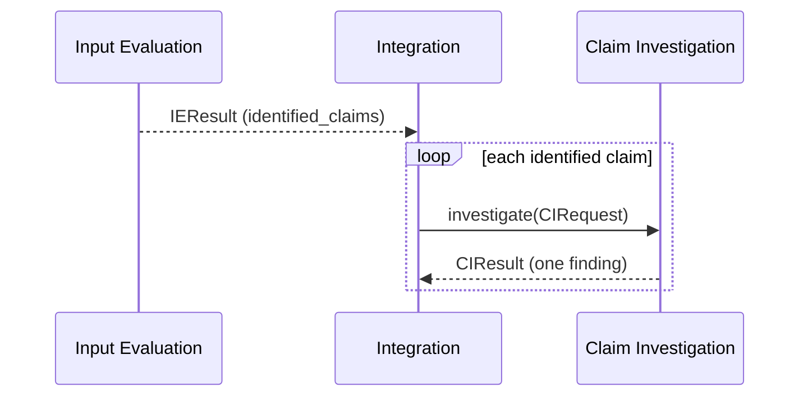

> **Draft**

# Interface Agreement: Claim Investigation - Integration (Integration's side)

The Claim Investigation (CI) team owns the CI to Integration direction. Their draft 0.2 is the contract for what CI sends back: `documentation/claim_investigation_interface_agreement.md` on the `claim-investigation` branch (draft, not approved). This page does not repeat it. It adds the part their draft does not cover, the request from Integration to CI, as a proposal, and says what Integration does with the results.

## Header

- **Interface name:** Claim Investigation - Integration
- **Owners:**
  - Integration: Meshaal Aldawood, @meshaalaldawood
  - Claim Investigation: Boyu Liu, @Kilo524
- **Status:** draft
- **Version:** 0.3
- **Date:** 2026-11-11

## 1 Purpose and scope

Integration sends CI one investigation request per claim that Input Evaluation (IE) identified. CI returns one result per claim. The result (outcome, evidence, unable-to-check reason) is CI's, as in their draft sections 4.1 to 4.3. Integration connects each result to its claim and report and passes it on unchanged.

## 2 Related documents

- CI draft 0.2 (above), sections 4 (items) and 6 (CI-IN-01 to CI-IN-06).
- [Input Evaluation - Integration agreement](input-evaluation-integration.md): IE's claims (`IEClaim`) and the routing inputs.
- [Integration requirements](../subsystems/integration/requirements.md): INT-4, INT-5, INT-7, INT-8, INT-9. [Verification](../subsystems/integration/verification.md).
- Code: the classes named `CI...` in `src/bugs26/integration/models.py` follow the CI draft (`CIResult`, `CIFinding`, `CIEvidence`); `CIRequest` is Integration's proposal. `interfaces.py` has the `ClaimInvestigator` Protocol. `stubs/claim_investigation_stub.py` is a placeholder.

## 3 Routing rule

Mechanical, one call per identified claim (this replaces the earlier rule based on an IE decision, which IE's draft does not have):

Integration does not call CI, and says why in `could_not_check`, when `processing_status` is `invalid_input` or `failed`, `claim_extraction.status` is `not_performed`, or `no_checkable_claims` is `true`.

## 4 Items that cross the interface

### 4.1 Request (Integration to CI): PROPOSED, not in the CI draft

`CIRequest` in `models.py`. Their draft covers only CI to Integration, and their requirements document calls this input "proposed for confirmation". CI should amend it.

| Field | Source | Meaning |
|---|---|---|
| `request_id` | Integration | The evaluation attempt; the same one IE got. |
| `claim_id` | IE | With `request_id`, the claim's key. |
| `claim_text` | IE | The exact claim. Not changed. |
| `source` | IE | IE's quotation evidence for the claim (lines in `raw_body`). Not changed. |
| `snapshot_id` | Integration | The snapshot the lines refer to. |
| `relevant_context` | IE | Exact excerpt around the claim. Not changed. |
| `named_project_versions` | IE | Versions the report states; `[]` if none. Not changed. |
| `repository` | Integration | `owner/project`, or `null` for pasted or uploaded reports. |
| `issue_url` | Integration | Issue URL, or `null`. |
| `title`, `raw_body` | Integration | The full original title and body. |

No reporter identity is sent (INT-9).

### 4.2 Result (CI to Integration)

Per the CI draft: a result tied to its claim, an outcome, evidence, and the reason when the claim could not be fully checked. The field names and values in the prototype are provisional, because their draft leaves them open (section 8):

| Field | Type | Note |
|---|---|---|
| `request_id`, `claim_id` | string | Echoed from the request. Their draft asks only for the claim id; Integration also asks for `request_id` because IE's claim key is (`request_id`, `claim_id`). |
| `findings` | list of `CIFinding` | Exactly one is expected. |
| `CIFinding.claim_id`, `outcome`, `explanation`, `evidence` | | `outcome` is `supported`, `contradicted` or `insufficient evidence` (their proposed values). `evidence` may be empty, as their CI-IN-03 says "when available". |
| `CIEvidence.type`, `reference`, `explanation` | string | Their proposed required information: type, reference (path or URL), short explanation. |
| `limitation` | string or null | Why the claim could not be fully checked (their section 4.3). |

### 4.3 What Integration does with a result

- Checks `request_id` and `claim_id` against the request. A result for another claim is a failure for this claim.
- Checks that there is exactly one finding for the claim. Zero or several is a failure for this claim. Nothing is shown for it, and `could_not_check` says why.
- Keeps the result, with its evidence, unchanged (INT-8, CI-IN-05).
- Puts `insufficient evidence` outcomes and `limitation` text in `could_not_check` (CI-IN-06). It never turns them into a definite result.
- If `investigate` raises, `could_not_check` says "Claim '...' not investigated: <error>", and the other claims go on. The placeholder CI raises "not connected" and invents no outcome.
- CI results accept extra fields: the CI schema is still open.

### 4.4 Connection

In-process Python call: `ClaimInvestigator.investigate(request: CIRequest) -> CIResult`. Provisional: their transfer mechanism is an open item.

## 5 Responsibilities

**Integration:** applies the routing rule; builds `CIRequest` without changing IE's claim fields; checks and connects results; keeps limits visible (R4); keeps no reporter record (INT-9).

**Claim Investigation:** as in section 5 of their draft.

## 6 Interface requirements

CI's CI-IN-01 to CI-IN-06. Integration's part is CI-IN-02 (claim id kept), CI-IN-05 (evidence stays with its result) and CI-IN-06 (uncertainty kept).

## 7 Verification

| CI requirement | Method | Test | Status |
|---|---|---|---|
| CI-IN-01 | Test | `tests/test_int_4.py::test_one_ci_call_per_claim`, `test_ci_receives_request_with_context` | Pass (stub) |
| CI-IN-02 | Test | `tests/test_int_4.py::test_ci_answer_for_another_claim_or_request_is_a_failure_not_a_result`, `tests/test_int_7.py::test_everything_links_to_its_report` | Pass |
| CI-IN-03 | Inspection | CI's evidence is shown as sent: `tests/test_int_8.py::test_ie_and_ci_results_pass_through_unchanged` | Pass (fakes) |
| CI-IN-04 | Test | `tests/test_int_4.py::test_ci_limit_and_insufficient_evidence_reach_could_not_check` | Pass (fakes) |
| CI-IN-05 | Test | `tests/test_int_8.py`, `tests/test_int_4.py::test_zero_or_several_findings_for_a_claim_is_a_failure` | Pass |
| CI-IN-06 | Test | `tests/test_int_4.py::test_ci_limit_and_insufficient_evidence_reach_could_not_check`, `tests/test_web.py::test_offline_demo_sample_lists_claims_as_not_investigated` | Pass |

## 8 Open items (for the CI team)

1. Confirm the request fields in 4.1.
2. Final outcome values and field names (their section 8). The prototype uses their proposed words.
3. Will CI echo `request_id` as well as `claim_id`?
4. Exactly one finding per claim, as their requirements say (CI-SR-05)? Their agreement lists it as open.
5. May a result with `insufficient evidence` have empty evidence? The prototype accepts it.
6. Does CI read the repository itself, and at which version when the report names none?
7. Feedback from Integration when a result cannot be connected (their section 5.3): the prototype records it in `could_not_check` and sends nothing back. Is that enough?
8. Transport and timeout. No timeout is defined; a call that does not return is not handled.
9. One call per claim, or one call per report?

## 9 Change history

| Version | Date | Author | Change |
|---|---|---|---|
| 0.1 | 2026-11-11 | Integration | First draft, proposed by Integration. |
| 0.2 | 2026-11-11 | Integration | Context, Protocol, failure handling. |
| 0.3 | 2026-11-11 | Integration | Conforms to the CI draft 0.2: their outcome words, one finding per claim, claim id on every result. Request to CI marked proposed. Routing is one call per IE claim; the decision-based rule (BRE-DR.11) is removed. |
| 0.3 (iter. 7) | 2026-11-11 | Integration | Request forwards the whole IE claim (`source`) and `snapshot_id`. CI result classes accept extra fields. The placeholder CI invents no outcome. |
