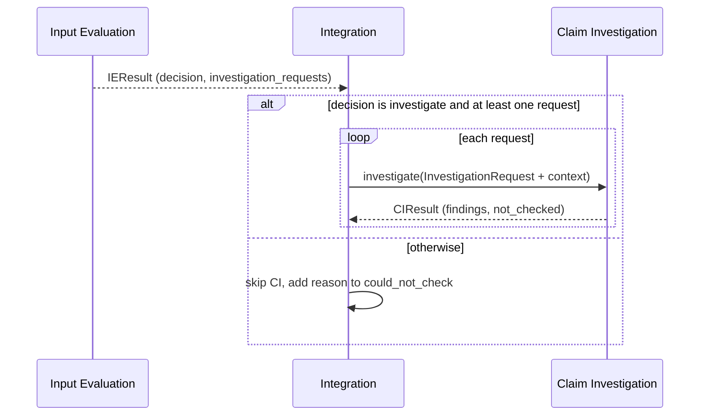

> **Draft**

# Interface Agreement: Claim Investigation - Integration

This is a proposal from Integration. The Claim Investigation team should amend it.

## Header

- **Interface name:** Claim Investigation - Integration
- **Owners:**
  - Integration: Meshaal Aldawood, @meshaalaldawood
  - Claim Investigation: TBD — Claim Investigation (Boyu or Qinyue)
- **Status:** draft
- **Version:** 0.2
- **Date:** 2026-11-11

## 1 Purpose and scope

Integration sends Claim Investigation (CI) one investigation request per claim, with context from the report. CI returns findings and the limits of what it checked. This page defines that exchange and the rule for when CI is called.

Integration coordinates this interface. It does not decide how CI works inside, or what CI reads. Everything about CI's side is a proposal for the CI team to accept or change.

Out of scope: how CI checks a claim, and which public sources it uses.

## 2 Related documents

- [System requirements](../system-requirements.md): R2, R3, R4, R6
- [Integration requirements](../subsystems/integration/requirements.md): INT-4, INT-5, INT-7, INT-8, INT-9
- [Integration verification](../subsystems/integration/verification.md)
- [Interface management](../interface-agreements.md)
- [Input Evaluation - Integration agreement](input-evaluation-integration.md)
- Team design notes: IF06, IF07, IF08 and routing rule BRE-DR.11
- Code: `src/bugs26/integration/models.py`, `src/bugs26/integration/interfaces.py`, `src/bugs26/integration/route.py`, `src/bugs26/stubs/claim_investigation_stub.py`

## 3 Interface description

Information interaction. Integration calls CI only if Input Evaluation (IE) decided `investigate` and sent at least one request (BRE-DR.11). It calls CI once per request.

If the decision is `request_more_information` or `do_not_investigate`, Integration skips CI and reports "Claims not investigated: <reason>". If the decision is `investigate` with no requests, it reports "No specific bug claim was identified".

## 4 Items that cross the interface

### 4.1 InvestigationRequest (Integration to CI)

**Direction:** Integration to Claim Investigation.

**Description:** One claim to check, with the report context CI needs. IE supplies the claim. Integration adds `context`. (INT-4)

**Characteristics:**

- Format: JSON matching `InvestigationRequest` in `src/bugs26/integration/models.py`.
- Frequency: once per claim, so zero or more per report.
- Connection method: in-process Python call, `ClaimInvestigator.investigate(request) -> CIResult`. The Protocol is in `src/bugs26/integration/interfaces.py`. The stub in `src/bugs26/stubs/claim_investigation_stub.py` is a placeholder. It returns `could_not_check` for every request. The real CI code replaces it: pass it as `investigator=` to `pipeline.run`, or change the default there.

| Field | Type | Meaning |
|---|---|---|
| `claim_id` | string | Unique id of the claim. |
| `report_id` | string | The report it belongs to. |
| `claim_text` | string | The claim to check. |
| `location` | object or null | `{"start": int, "end": int}` of the claim in the original body. |
| `context` | object | Set by Integration. See below. |
| `ie_context` | object | IE's own context for the claim. Passed through untouched. |

`context`, set by Integration:

| Key | Type | Meaning |
|---|---|---|
| `repo_url` | string or null | Repository URL, GitHub source only. |
| `issue_url` | string or null | Issue URL, GitHub source only. |
| `fields` | object | Text of each structured section that has content, by field name: `description`, `steps_to_reproduce`, `expected_behavior`, `observed_behavior`, `environment`. Each value is a list of strings. Empty sections and `_No response_` are left out. |

The request's `claim_text` and `location` come from IE. Integration does not extract code references or versions.
The context has no reporter identity (INT-9).

### 4.2 CIResult (CI to Integration)

**Direction:** Claim Investigation to Integration.

**Description:** Findings for the claim, with evidence, and what CI could not check. (INT-5, INT-8)

**Characteristics:**

- Format: JSON matching `CIResult` in `src/bugs26/integration/models.py`.
- Frequency: once per request.
- Connection method: return value of `investigate`. The stub is a placeholder.

`CIResult`

| Field | Type | Meaning |
|---|---|---|
| `report_id` | string | Must equal the request's `report_id`. |
| `findings` | list of `Finding` | One or more findings per claim. |
| `not_checked` | list of string | Limits or failures, with reasons (IF08). Integration removes repeats across requests. |

`Finding`

| Field | Type | Meaning |
|---|---|---|
| `finding_id` | string | Unique id of the finding. |
| `report_id` | string | The report it belongs to. Must match (INT-7). |
| `source` | `claim_investigation` | CI uses this value. |
| `subject` | string | The `claim_id` the finding is about. |
| `status` | `verified`, `refuted` or `could_not_check` | The result of checking the claim. |
| `statement` | string | The finding in words. |
| `evidence` | list of `Evidence` | What supports it (R3). |

`Evidence`

| Field | Type | Meaning |
|---|---|---|
| `kind` | `report_excerpt`, `file`, `url` or `note` | Type of evidence. |
| `ref` | string | Source reference, such as a file path or URL. Passed on unchanged (INT-8). |
| `excerpt` | string or null | Quoted text. |
| `start`, `end` | integer or null | Span in `original_body`, for `report_excerpt`. The result page computes line numbers from it. |

## 5 Responsibilities

**Integration:**

- Apply the routing rule and call CI only when it is met.
- Check that each request belongs to the report before sending it.
- Add `context` to each request.
- Pass `ie_context` through untouched.
- Reject CI findings whose `report_id` does not match.
- Pass evidence on unchanged, and keep limits from CI in the output (R4).
- Keep no record of the reporter (INT-9).

**Claim Investigation (proposed):**

- Return one `CIResult` per request.
- Set `report_id` on every finding, and `subject` to the `claim_id`.
- Cite evidence for every finding.
- State what it could not check in `not_checked`, and keep findings for other claims when one claim fails.
- Add no reporter identity to any item.

If `investigate` raises, Integration adds "Claim Investigation failed: <ExceptionType>: <message>" to `could_not_check`, keeps the findings from other requests, and goes on.

## 6 Interface requirements

| ID | Requirement | Traces to |
|---|---|---|
| IF-CI-1 | Integration shall call Claim Investigation only when Input Evaluation's decision is `investigate` and it sent at least one request. | INT-4, BRE-DR.11 |
| IF-CI-2 | Integration shall send each request with `context` containing `repo_url`, `issue_url` and `fields`. | INT-4 |
| IF-CI-3 | Integration shall refuse a request whose `report_id` differs from the report's. | INT-7 |
| IF-CI-4 | Claim Investigation shall return a `CIResult` whose `report_id` equals the request's, and set `report_id` on every finding. | INT-5, INT-7 |
| IF-CI-5 | Claim Investigation shall cite evidence for every finding. | R3 |
| IF-CI-6 | Claim Investigation shall list in `not_checked` what it could not check and why. | R4 |
| IF-CI-7 | Integration shall pass CI findings and evidence on without change. | INT-8 |
| IF-CI-8 | Integration shall show the reason when CI is skipped. | R4 |
| IF-CI-9 | Neither subsystem shall add an identity field for the reporter to any item. | INT-9, R6 |
| IF-CI-10 | Integration shall report a failed `investigate` call in `could_not_check` and keep the other findings. | R4 |

## 7 Verification

| ID | Method | Procedure | Test | Status |
|---|---|---|---|---|
| IF-CI-1 | Test | Run with each decision, with and without requests. Check when CI is called. | `tests/test_int_4.py::test_uc2_ci_skipped_unless_investigate`, `test_uc3_ci_skipped_without_requests` | Pass |
| IF-CI-2 | Test | Run with a recording investigator. Check the context. | `tests/test_int_4.py::test_ci_receives_request_with_context` | Pass (stub) |
| IF-CI-3 | Test | Send a request for another report. Check it is refused. | `tests/test_int_4.py::test_report_id_mismatch_is_rejected` | Pass |
| IF-CI-4 | Test | Return a finding for another report. Check it is refused. | `tests/test_int_7.py::test_finding_for_another_report_is_rejected` | Pass (stub) |
| IF-CI-5 | Test | Check every CI finding has evidence. | Not written. Needs real CI code. | Open |
| IF-CI-6 | Test | Check CI limits reach the maintainer output. | `tests/test_int_6.py::test_output_includes_collected_findings_and_r4` | Pass (stub) |
| IF-CI-7 | Test | Check evidence equals what CI sent. | `tests/test_int_8.py::test_evidence_unchanged_from_both_subsystems` | Pass |
| IF-CI-8 | Test | Check the skip reason is in `could_not_check`. | `tests/test_int_4.py::test_uc2_ci_skipped_unless_investigate` | Pass |
| IF-CI-10 | Test | Make the investigator raise. Check the failure is in `could_not_check` and the run continues. | `tests/test_int_4.py::test_ci_failure_is_reported_and_the_run_continues` | Pass |
| IF-CI-9 | Inspection | Use the INT-9 checklist on both sides. | [verification.md](../subsystems/integration/verification.md) | Open |

## 8 Open items

Each item: owner TBD, target before Gate 2 (2026-12-07).

1. Claim extraction is IE's job (Integration no longer extracts code references or versions). CI should confirm what it needs in a request (IF12), including whether `fields` is enough context.
2. Claim granularity. What counts as one claim, so that CI returns one finding per claim?
3. Decision vocabulary. The routing rule depends on IE's `investigate` value. CI and IE should agree on the values.
4. Repository access. Does CI need to read or clone the repository? If so, who clones it, and from which `repo_url` and version? The prototype gives CI only the URL and versions.
5. Timeouts. How long may one `investigate` call take? A raised exception is handled: Integration keeps findings from other claims and adds the failure to `could_not_check`. A call that does not return is not handled.
6. Python package or HTTP service. Integration proposes an in-process Python package that implements the `ClaimInvestigator` Protocol. If CI needs a service, the format and error handling must be defined.
7. Is one call per claim right, or should CI get all claims for a report in one call?

## 9 Change history

| Version | Date | Author | Change |
|---|---|---|---|
| 0.1 | 2026-11-11 | Integration | First draft, proposed by Integration. |
| 0.2 | 2026-11-11 | Integration | Context has `fields` instead of versions and code references. Protocol moved to `interfaces.py`. Evidence has no line fields. CI failure handling added. |
