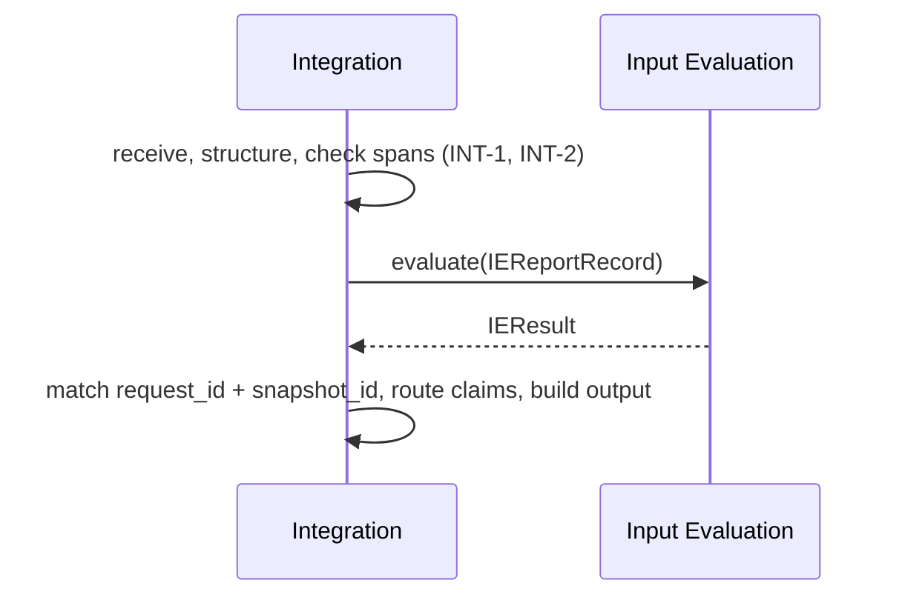

> **Draft**

# Interface Agreement: Input Evaluation - Integration (Integration's side)

The Input Evaluation (IE) team owns this interface. Their draft v1 is the contract:
`documentation/Interface Agreemtn/input-evaluation-integration.md` on the `Input-evaluation` branch (draft, version 1 proposed, 2026-11-10). This page does not repeat it. It says only what Integration does on its side, and where the prototype follows or differs from that draft.

## Header

- **Interface name:** Input Evaluation - Integration
- **Owners:**
  - Integration: Meshaal Aldawood, @meshaalaldawood
  - Input Evaluation: Julian Jiang, @Yulinjiang599
- **Status:** draft
- **Version:** 0.3 (Integration's side only)
- **Date:** 2026-11-11

## 1 Purpose and scope

Integration gives IE one report record per evaluation attempt and takes back one evaluation result. The record and result formats, the rating scale, the identifiers and the error codes are IE's. See sections 4.1 to 4.3 of their draft.

This page covers what Integration owns: receiving the report (INT-1), structuring it into IE's section schema (INT-2), sending it (INT-3), routing the claims onward (INT-4, see the [Claim Investigation agreement](claim-investigation-integration.md)), and showing the result to the maintainer (INT-5 to INT-8).

## 2 Related documents

- IE draft v1 (above), sections 4.1 (record), 4.2 (result), 4.3 (shared rules).
- [Integration requirements](../subsystems/integration/requirements.md): INT-1 to INT-9. [Verification](../subsystems/integration/verification.md).
- [System requirements](../system-requirements.md): R1, R2, R3, R4, R6.
- Code: the classes named `IE...` in `src/bugs26/integration/models.py` are IE's contract (`IEReportRecord`, `IESection`, `IEExtraction`, `IEResult`, `IEFinding`, `IEEvidence`, `IEClaim`, ...). They reject unknown fields, as the draft requires. `interfaces.py` has the `InputEvaluator` Protocol. `stubs/input_evaluation_stub.py` is a placeholder.

## 3 What Integration does

## 4 Integration's side of the items

### 4.1 Report record (Integration to IE)

Integration builds an `IEReportRecord` with these rules. Where a rule differs from the IE draft, it is marked.

- `raw_body` is the exact text. `""` is valid. `title` is `""` when there is none.
- `sections` come from `intake.structure`. A section starts at a markdown heading or a bold label line (`**Expected:** text`). Markers inside code fences and HTML comments are ignored. Each section has `section_id` (`s1`, `s2`, ...), `original_label`, `status` (`provided` or `blank`), `value`, `recognition`, optional `semantic_concept`, and `source_lines`.
- `value` is an exact slice of `raw_body`, without the heading line. A `provided` value has its leading and trailing whitespace cut off. A `blank` value keeps the exact whitespace string. "No response" and HTML comments are copied as they are; IE decides if they are useful.
- `source_lines` are 1-based, split on LF (a CRLF is one break), and cover the heading and the value. For an empty `blank` section the range is the heading line only (the draft's example 12 for an empty last section; Integration sends the heading line).
- `semantic_concept` uses the six concepts of the draft. Integration sets it from a small list of heading aliases (such as `Steps to reproduce`, `What happened?`, `Version`) and sends `null` plus `recognition: "unrecognized"` for any other heading.
- A report with no headings is free-form: `sections: []`, `extraction.mode: "free_form"`. Integration does not make up a description section.
- Text before the first heading is not a section. It stays in `raw_body` only.
- `absent` is never sent: no template is known, so `template_id`, `field_id` and `required` are `null`.
- `extraction.diagnostics` carries Integration's notes: `preamble_not_a_section`, `unrecognized_headings`, `no_headings_recognised`. They are not shown to the maintainer as gaps, because IE reads the raw text.
- Before sending, Integration checks every `value` against `raw_body`, its `source_lines`, and its label (`verify_structured`). If a check fails, the run stops with an error and IE is not called.
- `body_source` is always `current`: Integration cannot get the initial text. IE adds `not_initial_submission`.
- `request_id` and `snapshot_id` are new for each submission. `report_id` is Integration's own link key (INT-7) and is not sent.
- Differs from the draft (pending IE question Q3): a pasted or uploaded report has no `issue_number`, `issue_url`, `created_at` or `updated_at`, and `repository` only if the maintainer entered one. These are `null`, never made up. The draft requires them. IE should say whether `null` is acceptable for this case.

### 4.2 Evaluation result (IE to Integration)

- Integration matches the result to the request by `request_id` and `snapshot_id`. A mismatch, a result without exactly one finding for each of C1 to C7 (when `completed` or `partial`), or a repeated `claim_id` is a failure: the maintainer sees an error (HTTP 502), not a result. A result with `invalid_input` and a `null` `request_id` is accepted.
- The result is passed on as received (INT-8). The maintainer output contains the `IEResult` object itself.
- `could_not_check` (R4) is built from: `processing_status` other than `completed`; each unevaluated criterion with its reason; each `U` rating; `claim_extraction` that is not `completed`, with its reason; each `error` diagnostic; and the notes in 4.3 below.
- `invalid_input` and `failed` are shown as a failure, never as a completed evaluation. `partial` is shown with its limits.
- Integration has no decision field to read. IE's draft has none, so routing does not depend on one.

### 4.3 Claims

For each entry in `identified_claims`, Integration makes one Claim Investigation call (see the other agreement). Integration skips the calls, and says why in `could_not_check`, when `processing_status` is `invalid_input` or `failed`, `claim_extraction.status` is `not_performed`, or `no_checkable_claims` is `true`.

### 4.4 Connection

In-process Python call: `InputEvaluator.evaluate(record: IEReportRecord) -> IEResult`. Provisional, pending the IE transport decision (their open item 3, target 2026-11-24). No timeout is defined. If `evaluate` raises, Integration stops with "Input Evaluation failed" (HTTP 502).

## 5 Responsibilities

**Integration:** keeps the original verbatim; structures it without adding anything; checks its own spans; sends one record per attempt; matches the result; forwards findings, unevaluated criteria and claims unchanged; keeps no reporter record (INT-9).

**Input Evaluation:** as in section 5 of their draft.

## 6 Interface requirements

The requirements are IE's IF-1 to IF-12. Integration's part is IF-1, IF-2, IF-3, IF-10, IF-11 and IF-12.

## 7 Verification

| IE requirement | Method | Test | Status |
|---|---|---|---|
| IF-1, IF-2 | Test | `tests/test_int_1.py` (verbatim body and metadata), `tests/test_int_3.py::test_ie_receives_original_and_structured`, `test_github_metadata_is_sent` | Pass (stub) |
| IF-3 | Test | `tests/test_int_2.py`: `test_ie_draft_example_a1`, `test_status_blank_provided_and_exact_values`, `test_freeform_has_no_sections_and_no_invented_description`, `test_lines_split_on_lf_and_crlf_is_one_break`, `test_verify_catches_a_wrong_span`, `test_verify_catches_wrong_lines_label_and_status` | Pass |
| IF-10 | Test | `tests/test_int_8.py::test_ie_and_ci_results_pass_through_unchanged` | Pass |
| IF-11 | Test | `tests/test_int_4.py::test_ie_answer_for_another_request_is_a_failure`, `test_ie_result_without_seven_criteria_is_a_failure`, `test_ci_skipped_and_failure_shown_when_ie_rejected_or_failed` | Pass (fakes) |
| IF-12 | Inspection | [verification.md](../subsystems/integration/verification.md) | Open |
| IF-4 to IF-9 | IE's tests (their section 7) | Run against real IE code | Open |

## 8 Open items (for the IE team)

1. Q3: is `null` acceptable for `repository`, `issue_number`, `issue_url`, `created_at` and `updated_at` when the report is pasted or uploaded (not from GitHub)?
2. Q4: text before the first heading stays in `raw_body` only. Is that acceptable, or should it be an `unrecognized` section?
3. Can Integration ever supply `body_source: "initial"`, `field_id`, `required` or `template_id`? Today it cannot, so they are `current` and `null`.
4. Does a `U` rating count as "could not check" for the maintainer? The prototype lists it.
5. Transport and timeout (their open item 3).
6. Does IE need Integration to keep snapshots beyond one run (their section 4.3)? The prototype keeps nothing after the request (INT-9).
7. Which criteria version string does Integration pin? The placeholder uses `git:b1820e5:documentation/bug-report-quality-criteria.md`.

## 9 Change history

| Version | Date | Author | Change |
|---|---|---|---|
| 0.1 | 2026-11-11 | Integration | First draft, proposed by Integration. |
| 0.2 | 2026-11-11 | Integration | Code references and versions moved to IE. Protocols moved to `interfaces.py`. |
| 0.3 | 2026-11-11 | Integration | Conforms to the IE draft v1. Our own record, result and decision definitions removed. This page now covers Integration's side only. |
