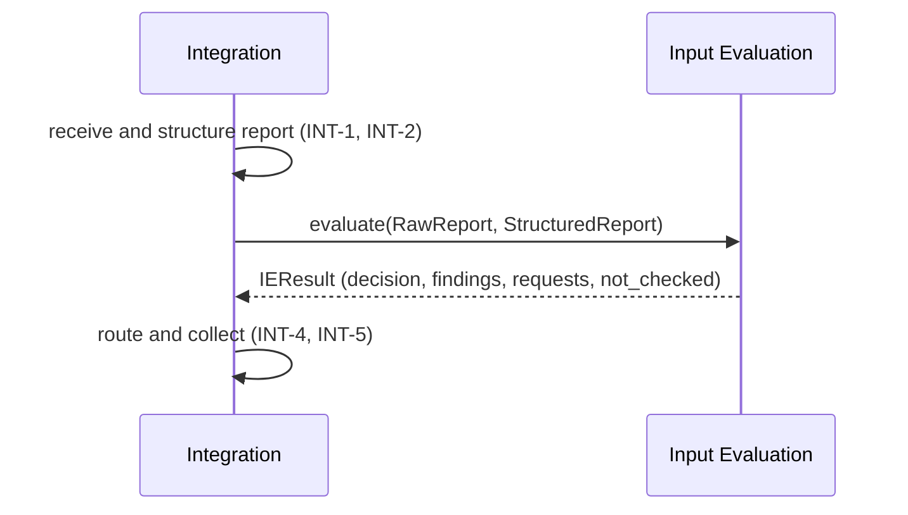

> **Draft**

# Interface Agreement: Input Evaluation - Integration

This is a proposal from Integration. The Input Evaluation team should amend it.

## Header

- **Interface name:** Input Evaluation - Integration
- **Owners:**
  - Integration: Meshaal Aldawood, @meshaalaldawood
  - Input Evaluation: TBD — Input Evaluation (Julian or Lurui)
- **Status:** draft
- **Version:** 0.2
- **Date:** 2026-11-11

## 1 Purpose and scope

Integration gives Input Evaluation (IE) the original and structured bug report. IE gives back a decision, findings, and requests for Claim Investigation. This page defines that exchange.

Integration coordinates this interface. It does not decide how IE works inside. Everything about IE's side is a proposal for the IE team to accept or change.

Out of scope: how IE judges quality, and how IE finds claims.

## 2 Related documents

- [System requirements](../system-requirements.md): R1, R2, R3, R4, R6
- [Integration requirements](../subsystems/integration/requirements.md): INT-2, INT-3, INT-4, INT-5, INT-7, INT-8, INT-9
- [Integration verification](../subsystems/integration/verification.md)
- [Interface management](../interface-agreements.md)
- [Claim Investigation - Integration agreement](claim-investigation-integration.md)
- Team design notes: IF02, IF03 (to IE) and IF04, IF05 (from IE)
- Design IDs (IF02, IF05, BRE-DR.11 ...) come from the team's SYSEN 5100 design compendium (HW7). Short definitions are in the glossary in [PROTOTYPE.md](../../PROTOTYPE.md).
- Code: `src/bugs26/integration/models.py`, `src/bugs26/integration/interfaces.py`, `src/bugs26/integration/pipeline.py`, `src/bugs26/stubs/input_evaluation_stub.py`

## 3 Interface description

Information interaction. Once per report, Integration calls IE with the report. IE returns one result.

## 4 Items that cross the interface

### 4.1 RawReport and StructuredReport (Integration to IE)

**Direction:** Integration to Input Evaluation.

**Description:** The original report, kept verbatim, and the same report split into sections. Every section is an exact slice of the original body. Nothing is added. (INT-2, INT-3)

**Characteristics:**

- Format: JSON matching the pydantic models in `src/bugs26/integration/models.py`.
- Frequency: once per report.
- Connection method: in-process Python call, `InputEvaluator.evaluate(raw, structured) -> IEResult`. The Protocol is in `src/bugs26/integration/interfaces.py`. The stub in `src/bugs26/stubs/input_evaluation_stub.py` is a placeholder. The real IE code replaces it: pass it as `evaluator=` to `pipeline.run`, or change the default there.

`RawReport`

| Field | Type | Meaning |
|---|---|---|
| `report_id` | string | New unique id for this submission. |
| `original_title` | string or null | GitHub issue title. Null for pasted or uploaded reports. |
| `original_body` | string | The report text, verbatim. |
| `sha256` | string | Hash of title (or empty string), a newline, and body. |
| `received_at` | datetime | When Integration received it (UTC). |
| `source` | `paste`, `upload` or `github` | How the report arrived. GitHub reports are accepted only from repositories listed in `src/bugs26/integration/supported_repos.txt`. |
| `repo_url` | string or null | Repository URL, `https://github.com/OWNER/REPO`, and the repository must be in `supported_repos.txt`. Set for GitHub reports. A pasted or uploaded report has one only if the maintainer entered it; it is validated the same way. |
| `issue_url` | string or null | Issue URL, GitHub source only. |

There is no field for the reporter (INT-9).

`StructuredReport`

| Field | Type | Meaning |
|---|---|---|
| `report_id` | string | Same id as the `RawReport`. |
| `title` | string or null | The original title. Never derived. |
| `fields` | map of string to list of `Section` | Sections by field name: `description`, `steps_to_reproduce`, `expected_behavior`, `observed_behavior`, `environment`. A name can hold more than one section. |
| `unmapped` | list of `Section` | Preamble and sections with an unknown heading. |

A report with no headings at all (freeform text) has its whole text in `description`. Integration does not extract code references or versions. IE finds the claims it needs, in `original_body`.

`Section`

| Field | Type | Meaning |
|---|---|---|
| `label` | string or null | Heading text as written. Null if there is none. |
| `text` | string | Section text. |
| `start`, `end` | integer | Character span. `original_body[start:end] == text`. |

### 4.2 IEResult (IE to Integration)

**Direction:** Input Evaluation to Integration.

**Description:** The quality assessment, findings, and the claims for Claim Investigation. (INT-4, INT-5)

**Characteristics:**

- Format: JSON matching `IEResult` in `src/bugs26/integration/models.py`.
- Frequency: once per report.
- Connection method: return value of `evaluate`. The stub is a placeholder.

`IEResult`

| Field | Type | Meaning |
|---|---|---|
| `report_id` | string | Must equal the report's `report_id`. |
| `decision` | `investigate`, `request_more_information` or `do_not_investigate` | What should happen next. Default `do_not_investigate`. |
| `reason` | string | Why IE decided this. Shown to the maintainer when Claim Investigation is skipped. |
| `missing_information` | list of string | What the report lacks. |
| `findings` | list of `Finding` | IE's findings. |
| `investigation_requests` | list of `InvestigationRequest` | Claims for Claim Investigation. |
| `not_checked` | list of string | What IE could not check, with reasons (R4). |

`Finding`

| Field | Type | Meaning |
|---|---|---|
| `finding_id` | string | Unique id of the finding. |
| `report_id` | string | The report it belongs to. Must match (INT-7). |
| `source` | `input_evaluation` or `claim_investigation` | Who produced it. IE uses `input_evaluation`. |
| `subject` | string | Human-readable. For IE findings, the quality criterion name, such as `steps to reproduce`. |
| `status` | `present`, `not_found` or `unable_to_judge` for IE | The result. The model also allows `verified`, `refuted` and `could_not_check`, which are for Claim Investigation. |
| `statement` | string | The finding in words. |
| `evidence` | list of `Evidence` | What supports it (R3). |

`Evidence`

| Field | Type | Meaning |
|---|---|---|
| `kind` | `report_excerpt`, `file`, `url` or `note` | Type of evidence. |
| `ref` | string | Source reference. Passed on unchanged (INT-8). |
| `excerpt` | string or null | Quoted text. |
| `start`, `end` | integer or null | Span in `original_body`, for `report_excerpt`. The result page computes line numbers from it. |

`InvestigationRequest`

| Field | Type | Meaning |
|---|---|---|
| `claim_id` | string | Unique id of the claim. |
| `report_id` | string | Must match the report. |
| `claim_text` | string | The claim to check. |
| `location` | object or null | `{"start": int, "end": int}` in `original_body`. |
| `context` | object | Set by Integration, not IE. See the Claim Investigation agreement. |
| `ie_context` | object | IE's own context. Passed through untouched. |

## 5 Responsibilities

**Integration:**

- Keep the original report verbatim and check that each structured section matches it.
- Send both versions to IE.
- Reject IE output whose `report_id` does not match.
- Collect IE's findings and pass evidence on unchanged.
- Keep no record of the reporter (INT-9).

**Input Evaluation (proposed):**

- Return one `IEResult` per report.
- Set `report_id` on every finding and request.
- Cite evidence for every finding.
- State what it could not check in `not_checked`.
- Add no reporter identity to any item.

If `evaluate` raises, Integration stops and shows "Input Evaluation failed" with the error type (HTTP 502). It does not show a partial result.

## 6 Interface requirements

| ID | Requirement | Traces to |
|---|---|---|
| IF-IE-1 | Integration shall send both the `RawReport` and the `StructuredReport` to Input Evaluation for every report. | INT-3, R1 |
| IF-IE-2 | Integration shall ensure that every structured section is an exact slice of the original body before sending. | INT-2 |
| IF-IE-3 | Input Evaluation shall return one `IEResult` per report, with `report_id` equal to the report's id. | INT-5, INT-7 |
| IF-IE-4 | Input Evaluation shall set `report_id` on every finding and investigation request it returns. | INT-7, R3 |
| IF-IE-5 | Input Evaluation shall cite evidence for every finding. | R3 |
| IF-IE-6 | Input Evaluation shall list in `not_checked` what it could not check. | R4 |
| IF-IE-7 | Integration shall pass IE's findings, evidence and `ie_context` on without change. | INT-8 |
| IF-IE-8 | Neither subsystem shall add an identity field for the reporter to any item. | INT-9, R6 |

## 7 Verification

| ID | Method | Procedure | Test | Status |
|---|---|---|---|---|
| IF-IE-1 | Test | Run with a recording evaluator. Check it gets both versions. | `tests/test_int_3.py::test_ie_receives_original_and_structured` | Pass (stub) |
| IF-IE-2 | Test | Structure samples and check spans. | `tests/test_int_2.py::test_span_invariant_on_samples`, `test_verify_catches_a_wrong_span` | Pass |
| IF-IE-3 | Test | Run with the real IE and check the result type and id. | Not written. Needs real IE code. | Open |
| IF-IE-4 | Test | Return a finding or request for another report. Check it is refused. | `tests/test_int_7.py::test_finding_for_another_report_is_rejected`, `test_request_for_another_report_is_rejected` | Pass (stub) |
| IF-IE-5 | Test | Check every IE finding has evidence. | Not written. | Open |
| IF-IE-6 | Test | Check `not_checked` reaches the maintainer output, including the C6/C7 limit. | `tests/test_int_6.py::test_output_includes_collected_findings_and_r4` | Pass (stub) |
| IF-IE-7 | Test | Check evidence equals what IE sent, and `ie_context` reaches CI untouched. | `tests/test_int_8.py::test_evidence_unchanged_from_both_subsystems`, `tests/test_int_4.py::test_ci_receives_request_with_context` | Pass |
| IF-IE-8 | Inspection | Use the INT-9 checklist on both sides. | [verification.md](../subsystems/integration/verification.md) | Open |

## 8 Open items

Each item: owner TBD, target before Gate 2 (2026-12-07).

1. Claim extraction. Integration no longer extracts code references or versions. The placeholder IE does it with a regex. Real IE returns claims in `investigation_requests`, with `location` (IF05). IE should confirm.
2. Claim granularity. What counts as one claim? One sentence, one statement, one code reference? Integration proposes one checkable statement per request.
3. Decision vocabulary. The prototype uses `investigate`, `request_more_information`, `do_not_investigate`. The design notes talk of "sufficient". IE should confirm or change the values.
4. Preparation issues (IF03). The prototype does not send IE a list of parts it could not map. Should it? Integration proposes adding a field to `StructuredReport`.
5. Timeouts. How long may `evaluate` take? A raised exception is handled (error page). A call that does not return is not.
6. Python package or HTTP service. Integration proposes an in-process Python package that implements the `InputEvaluator` Protocol. If IE needs a service, the format and error handling must be defined.
7. Field names in `StructuredReport.fields`. IE should confirm which sections it needs (IF11).

## 9 Change history

| Version | Date | Author | Change |
|---|---|---|---|
| 0.1 | 2026-11-11 | Integration | First draft, proposed by Integration. |
| 0.2 | 2026-11-11 | Integration | Code references and versions moved to IE. Protocols moved to `interfaces.py`. Evidence has no line fields. Supported repositories, freeform rule and IE failure handling added. |
